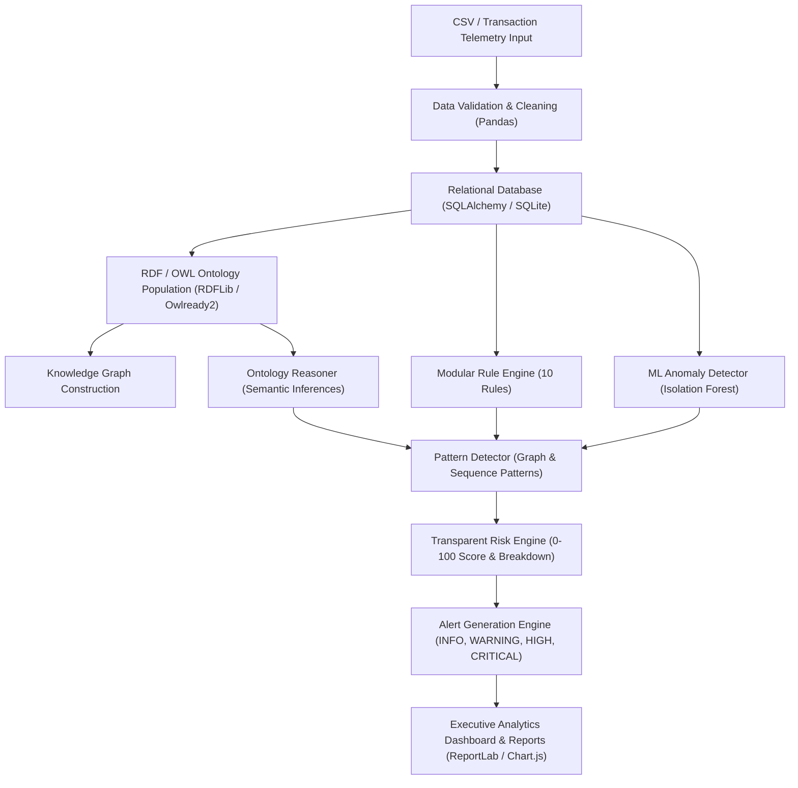

# Money Laundering Detection System — System Architecture

## 1. Pipeline Overview

The system processes financial transaction telemetry through a multi-engine architecture comprising data cleaning, database persistence, RDF ontology population, multi-rule evaluation, machine learning anomaly detection, semantic reasoning, risk scoring, and automated alert generation.

---

## 2. Multi-Engine Detection Architecture

### A. Rule Engine (10 Modular Rules)
1. **Large Transaction Anomaly:** Flagged if amount exceeds configured threshold ($50,000).
2. **Transaction Frequency:** Flagged if > 5 transactions executed from account within 24h.
3. **Structuring / Smurfing:** Flagged if multiple transactions are routed between $8,000 and $9,999.
4. **Rapid Pass-Through Transfer:** Flagged if funds received are rapidly moved out within 6h.
5. **Circular Transaction Loop:** Flagged if reciprocal transfers return funds back to originating account.
6. **Cross-Border Activity:** Flagged if sender country != receiver country.
7. **High-Risk Jurisdiction:** Flagged if transaction involves blacklisted countries (e.g. Panama, Cayman Islands).
8. **Fan-In Aggregation:** Flagged if account gathers funds from >= 4 senders in 24h.
9. **Fan-Out Dispersal:** Flagged if account disperses funds to >= 4 receivers in 24h.
10. **Dormant Account Activity:** Flagged if sudden high-value transfer occurs after > 90 days inactivity.

### B. Machine Learning Engine
- **Model:** Scikit-learn `IsolationForest`
- **Features:** Amount, transaction frequency, cross-border binary indicator.
- **Output:** Normalized decision score (0-100).

### C. Ontology Reasoner Engine
- Maps entities into Protégé OWL classes (`Customer`, `Account`, `Transaction`, `SuspiciousTransaction`, `HighRiskCountry`, `SmurfingPattern`, `LayeringPattern`).
- Evaluates semantic antecedents and enriches detection results with step-by-step explainability.

---

## 3. Transparent Risk Scoring Formula

$$\text{Risk Score} = \min\Big(100, \; S_{\text{Amount}} + S_{\text{Freq}} + S_{\text{Pattern}} + S_{\text{Geo}} + S_{\text{Hist}}\Big)$$

- **Amount Anomaly Factor:** 0 – 25 points
- **Frequency Anomaly Factor:** 0 – 20 points
- **Transaction Pattern Factor:** 0 – 25 points
- **Geographic Factor:** 0 – 15 points
- **Historical / ML Anomaly Factor:** 0 – 15 points

### Risk Ratings:
- **0 – 30:** Low Risk
- **31 – 70:** Medium Risk
- **71 – 100:** High Risk (Suspicious Flag)
